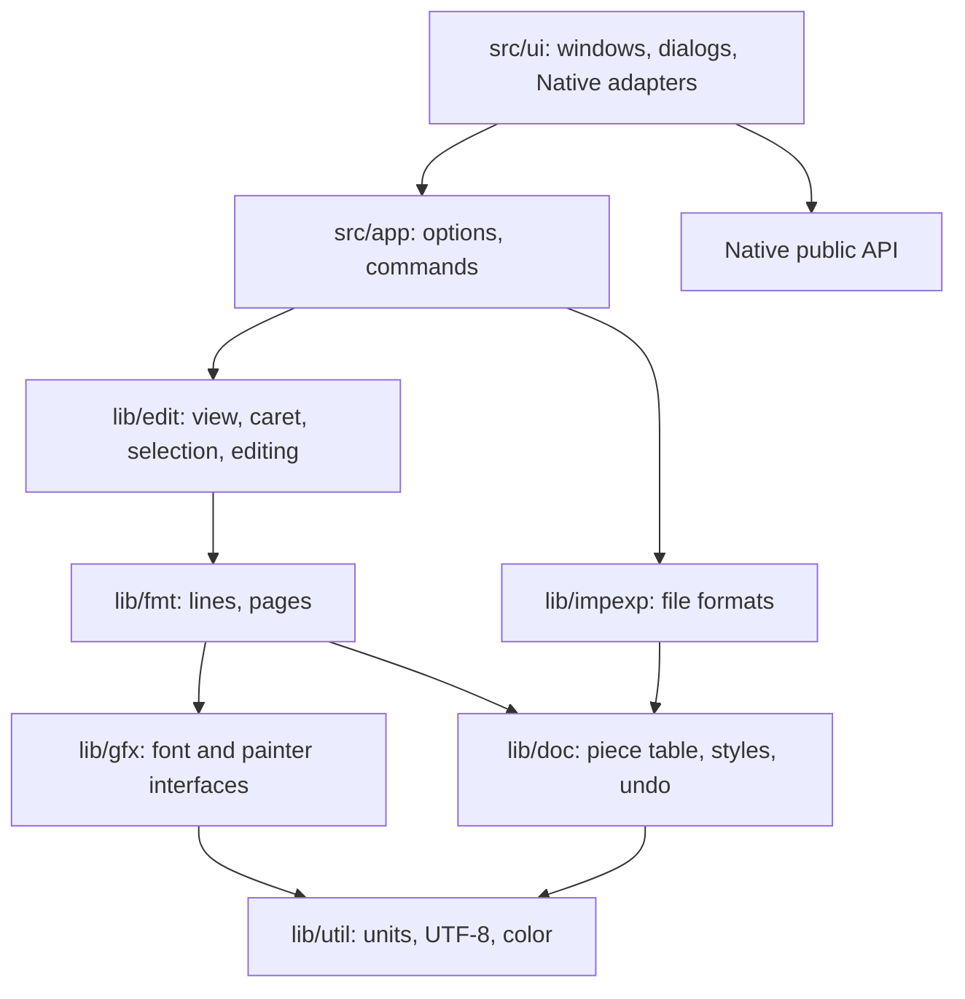

# Writer architecture

Writer (codename **fyodor**) is AbiWord rebuilt from the ground up on the
Native UI library. It reads and writes AbiWord's `.abw` format and keeps the
ideas that make AbiWord work. It replaces the C-with-classes code, GObject and
the per-platform front ends with modern C++20 and one UI layer.

This records the decisions and why they were made. Port coverage is in
[notes/PORT-STATUS.md](notes/PORT-STATUS.md).

## Layers

Dependencies point downward only. Everything except `src/ui/` builds and tests
without a display.

| Library | AbiWord origin | Holds |
| --- | --- | --- |
| `lib/util` | `af/util` | Units, UTF-8, colors |
| `lib/doc` | `text/ptbl` | Piece table, change history, styles, property cascade |
| `lib/gfx` | `af/gr` | `font_provider` and `painter` interfaces |
| `lib/fmt` | `text/fmt` (`fl_`, `fp_`, `fb_`) | Blocks, runs, lines, pagination |
| `lib/edit` | `text/fmt` (`fv_`), `af/ev` | View, caret, selection, commands |
| `lib/impexp` | `wp/impexp` | AWML, text and HTML |
| `src/ui` | `wp/ap`, `af/xap` | Native front end |

All application UI uses Native's public API. No file outside Native includes
SDL or any other toolkit header. A missing UI capability is added to Native,
following Native's own rules. See [notes/NATIVE-CHANGES.md](notes/NATIVE-CHANGES.md).

## Decisions

### Keep the piece table

AbiWord's core idea survives unchanged. Text lives in an append-only buffer and
a document is an ordered list of fragments over it. Nothing is erased, so undo
only re-links fragments. Fragments live in a red-black tree indexed by
left-subtree length, which makes position lookup logarithmic.

Changed from AbiWord:

- A fragment is its own tree node (intrusive) and null replaces the shared
  sentinel leaf. Ownership is `std::unique_ptr` at the tree's interface.
- AbiWord's two-buffer `pt_VarSet` becomes one `std::u32string`, because loading
  and editing no longer need different growth strategies.
- AbiWord's `FmtMark` zero-length fragment is dropped. Pending formatting at a
  collapsed caret is view state, applied on the next insert.

### Edits are planners over primitive records

Each public edit walks fragments and emits primitive `change_record`s. Primitive
application takes only a record, so undo replays the same code through
`inverted()`. Forward and backward paths cannot diverge, and a layout listener
needs no undo-specific code.

Coalescing can merge fragments across the bounds of an edit in progress, so
planning loops re-establish fragment boundaries on every step. Do not cache a
fragment or its length across a `commit`.

### Interned formatting

Attribute and property sets are interned in `attr_prop_table`, so a fragment
stores one index and a format change swaps it. Equal sets have equal indices,
which makes the coalescing test a plain comparison.

### Layout units

Layout works in integers of 1/1440 inch, as AbiWord does. Pagination therefore
never depends on zoom or display. Device pixels appear only while painting.

### Graphics is two interfaces

`GR_Graphics` is split into `font_provider` (measuring, lives as long as the
layout) and `painter` (drawing, lives for one paint). `fixed_font_provider`
measures with exact synthetic metrics, so layout tests need no fonts and no
display.

### WYSIWYG text

Advance widths come from one reference size of a face and are scaled, so the
same text wraps identically at every zoom. Fonts are sized by em (see
`font_size_basis`), which is what a point size means. Each word is drawn at its
exact layout position, so hinted screen advances cannot accumulate across a
line. Kerning inside a word is applied by the rasterizer but not by layout, so
a caret inside a kerned word can be off by under a pixel.

### Runs are polymorphic

AbiWord switches on run type throughout the line breaker. Here each `run`
subclass measures and draws itself and maps offsets to x. Alignment stays a few
lines in `finish_line` because a class per alignment added nothing once the
screen-erasure logic of `fb_Alignment` was gone.

### Reformat blocks, reflow everything

A change marks blocks dirty. `update()` reformats those and then reflows all
lines to pages. Reformatting is the expensive step and is proportional to the
paragraph. Reflow is linear in lines but only copies placements. AbiWord's
incremental column breaking is not ported, because it is the largest source of
complexity in `fl_DocLayout` and this design has not needed it.

Pending redraw tracking is gone for the same reason: the front end repaints from
current layout state instead of AbiWord's erase-and-draw sequences.

### File format compatibility

`.abw` is the native format and stays loadable by AbiWord. Unknown elements are
skipped. Header and footer sections are preserved on save although not yet laid
out. What cannot be kept is reported through `import_result::warnings`, never
dropped silently.

Saving writes a sibling temporary file and renames it, so a failed save cannot
destroy the previous document.

### Native first in the UI

Toolbars, rulers, status bars, combo boxes, dialogs and scrolling are Native
controls, and application UI needs are met by extending them. The format
toolbar hosts its font, size and style boxes through `tool_kind::control`. The
rulers are plain `native::ruler` objects: their margin, indent and tab markers
are `ruler_marker`s, and a finished drag becomes a document change in
`main_window`. Toolbar icons are new 16×16 designs drawn through Native's `gpx`,
not AbiWord's XPM artwork.

### One test source for every backend

UI tests enter through Native's public `on_native_*` functions and never name a
toolkit, so the same file runs on each backend. See
[notes/TESTING.md](notes/TESTING.md).

### Licensing

The port is derived from AbiWord and keeps its terms: GPL-2.0-or-later. See
[notes/LICENSING.md](notes/LICENSING.md).
